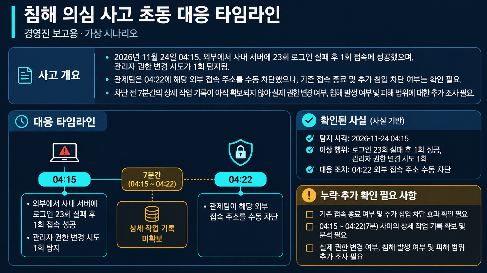

# 1-1. IR 서기 — 침해사고 초동 대응 보고서

보안관제센터(SOC)의 비정형 알람 메모를 근거 기반 초동 대응 보고서로 정리하는 LLM 프롬프트 설계·검증 과제입니다. 가상 시나리오를 사용하여 모델 비교, 시스템 프롬프트 개선, 환각 검증과 출력 일관성 확인을 수행했습니다.

## 과업 개요

- **사용자:** 야간·주말 교대 근무 중인 SOC 초동 분석가
- **입력:** 탐지 시각, 호스트/IP, 계정, 프로세스, 관제 메모 및 기존 대응 결과
- **출력:** 사고 개요 / 확인된 사실 / 누락·추가 확인 필요 사항 / 권고 초동 조치
- **핵심 원칙:** 입력에 없는 정보를 생성하지 않고, 확인된 사실과 미확인 사항 및 조치 효과를 구분합니다. 필수 정보가 부족하면 확인 질문을 먼저 제시합니다.

## 파일 구성

```text
1-1/
├── README.md
├── model-comparison.md
├── system-design.md
├── run-log.md
├── unresolved.md
├── image-generation.md
└── incident-timeline.png
```

| 문서 | 내용 |
|---|---|
| [모델 비교 및 선정](model-comparison.md) | GPT·Claude·Gemini의 동일 입력 비교, 평가 기준 및 선정 근거 |
| [시스템 설계](system-design.md) | 페르소나, v1·v2 시스템 프롬프트, 입력 템플릿, 검증 및 개선 이력 |
| [실행 로그](run-log.md) | 모델 비교 원문, v1 20턴·v2 18턴 대화와 검증 색인 |
| [미해결 기록](unresolved.md) | v2에서 남은 세부 조사 항목 누락과 데이터 한계 |
| [보너스: 이미지 생성](image-generation.md) | 경영진 보고용 타임라인의 원문, 생성 방식 및 결과 검토 |

## 진행 과정 및 결과

1. 세 모델에 정상 입력과 모호한 입력을 제공하고 8개 기준으로 비교했습니다. 문서의 선정안은 GPT-6.2입니다.
2. IR 서기 페르소나와 Few-shot 예시를 포함한 v1 시스템 프롬프트를 작성했습니다.
3. 사실 확인, 모호한 입력, 사건 전환, 3줄 요약 및 동일 입력 반복을 검증했습니다.
4. v2에는 미확인 사유·확인 절차, 답변 근거, 수행 조치와 실제 효과의 구분 및 고정 출력 순서를 추가했습니다.
5. v2에서 근거·절차 제시와 반복 출력의 개선을 확인했습니다. 다만 표준 보고서에서 취약점/CVE와 최초 문서의 파일명·저장 경로 확인 항목이 누락되는 한계가 남았습니다.

결과는 수록된 대화 범위에 대한 관찰이며, 모델의 일반 성능이나 반복 실행의 일관성을 보장하지 않습니다. 세부 판정과 근거는 설계 문서 및 실행 로그를 참조합니다.

## 사용 순서

1. [시스템 설계 문서](system-design.md)의 **5.2 시스템 프롬프트 v2**를 사용 중인 LLM의 지침 입력란 또는 새 대화에 입력합니다.
2. **5.3 유저 프롬프트**의 예시 또는 **5.4 재사용 가능한 입력 템플릿**에 관제 메모를 작성하여 전달합니다.
3. 출력된 사실을 원문과 대조하고, 미확인 항목은 관련 로그·파일·내부 규정으로 확인합니다.

이 폴더는 프롬프트와 실험 기록으로 구성되어 별도의 프로그램 설치나 빌드가 필요하지 않습니다. 실제 보안 도구 연동이나 차단·격리를 수행하지 않으며, 보고서 최종 사용 전 담당자의 검토가 필요합니다.

## 보너스 결과물

v2의 경영진 보고용 3줄 요약을 바탕으로 제작한 가상 사고 타임라인입니다.


