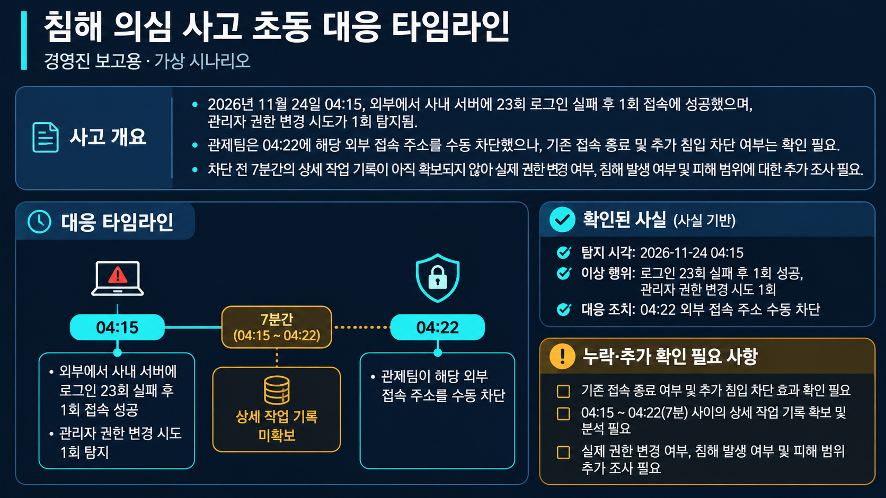

# 보너스 과제 2 | AI 응답의 시각 자료 변환

> 기존 대화 응답을 이미지 생성 AI에 전달하여 경영진 보고용 타임라인을 제작하였다.

## 1. 수행 목적 및 환경

- 선택 과제: 2번 — 요구사항 5의 AI 응답을 이미지로 변환
- 도구: ChatGPT 이미지 생성 기능
- 원문 출처: [실행 로그의 v2 대화](run-log.md#v2-log), T10 (TEST 4 응답)
- 결과물: 가상 침해 의심 사고의 초동 대응 타임라인 PNG 1장

## 2. 이미지 생성에 사용한 AI 응답 원문

다음 세 줄은 v2 실행 로그의 AI 응답 본문을 그대로 발췌한 것이다.

```text
- 2026년 11월 24일 04:15, 외부에서 사내 서버에 23회 로그인 실패 후 1회 접속에 성공했으며, 관리자 권한 변경 시도가 1회 탐지됨.
- 관제팀은 04:22에 해당 외부 접속 주소를 수동 차단했으나, 기존 접속 종료 및 추가 침입 차단 여부는 확인 필요.
- 차단 전 7분간의 상세 작업 기록이 아직 확보되지 않아 실제 권한 변경 여부, 침해 발생 여부 및 피해 범위에 대한 추가 조사 필요.
```

## 3. 이미지 생성 방식

기존 응답을 바탕으로 경영진 보고용 보안 사고 타임라인 인포그래픽을 생성하였다. 시각화에는 탐지 시각, 수동 차단 시각, 7분간 상세 작업 기록 미확보 상태, 확인된 사실과 추가 확인 필요 사항을 구분하는 구성을 적용하였다. 원문을 사실관계의 기준으로 사용하였으며 이미지에 맞춰 실행 로그를 수정하지 않았다.

## 4. 생성 결과



[PNG 원본](incident-timeline.png)

## 5. 결과 검토

| 확인 항목 | 결과 |
|---|---|
| 탐지 시각 04:15 | 반영 |
| 로그인 23회 실패 후 1회 성공, 권한 변경 시도 1회 | 반영 |
| 04:22 외부 접속 주소 수동 차단 | 반영 |
| 7분간 상세 작업 기록 미확보 | 반영 |
| 기존 접속 종료·추가 침입 차단·피해 범위 미확인 | 추가 확인 필요 사항으로 분리 |

생성 이미지는 가상 시나리오의 보고 자료이며 실제 침해 발생이나 차단 효과를 입증하는 자료가 아니다. 원문과 이미지를 함께 보관하여 사실관계를 대조할 수 있도록 하였다.
